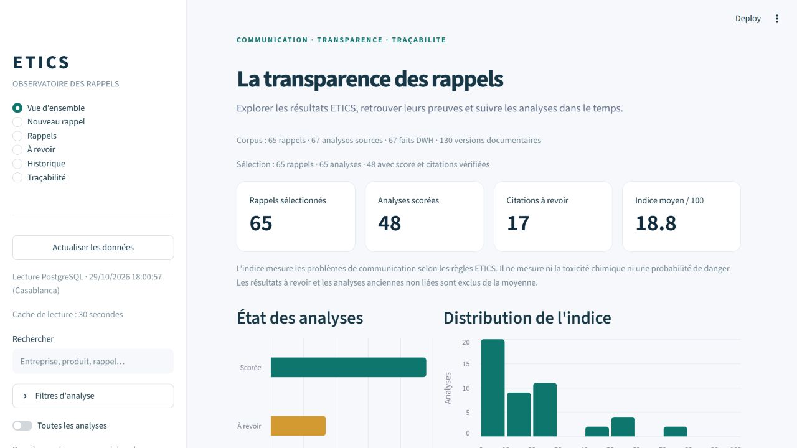
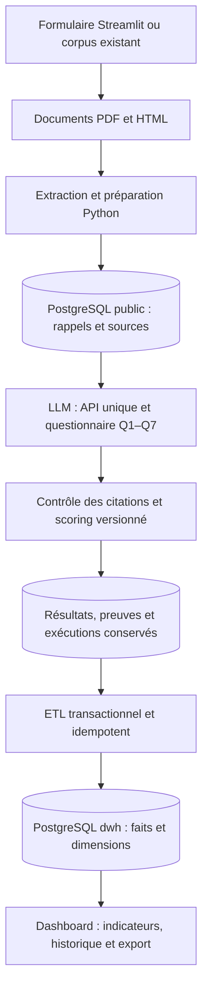
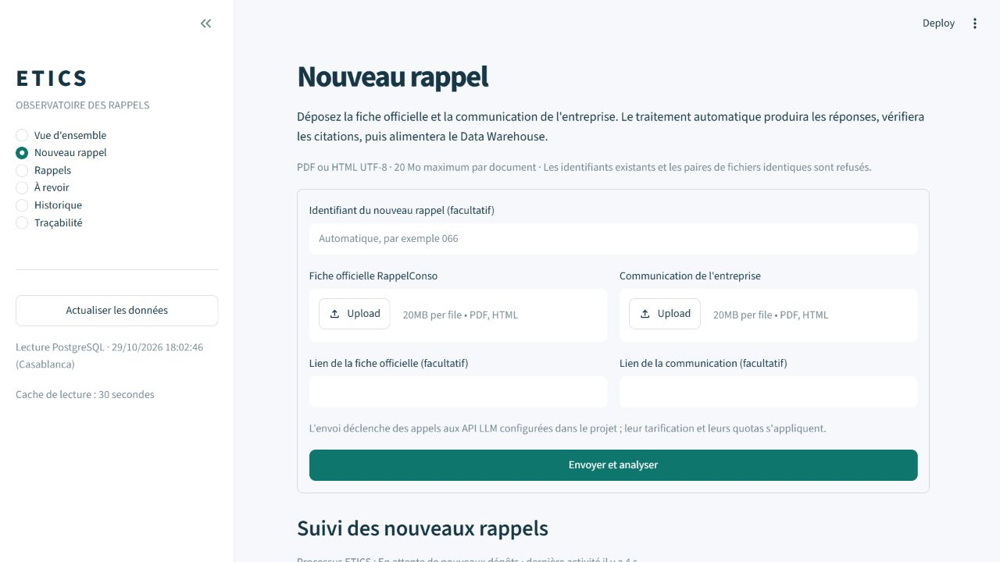
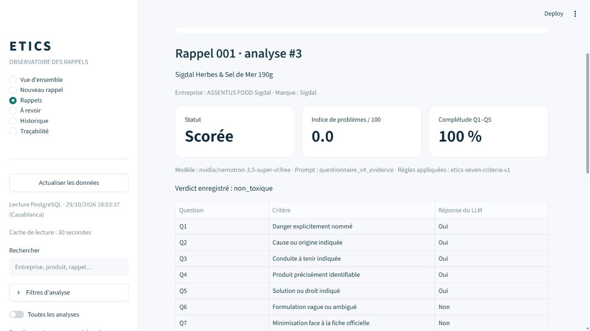
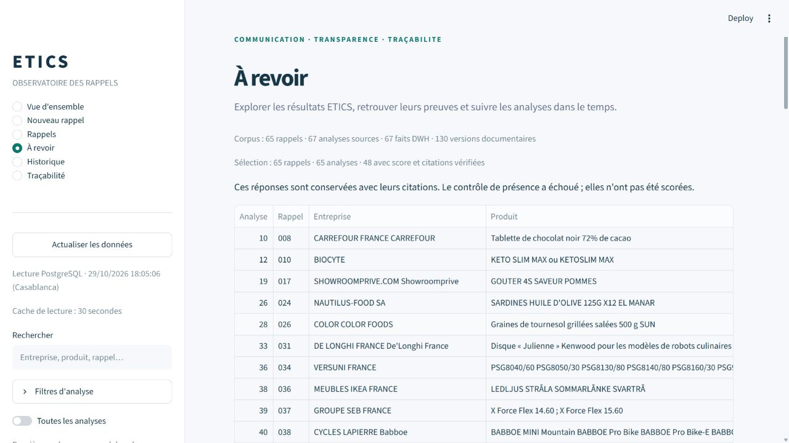
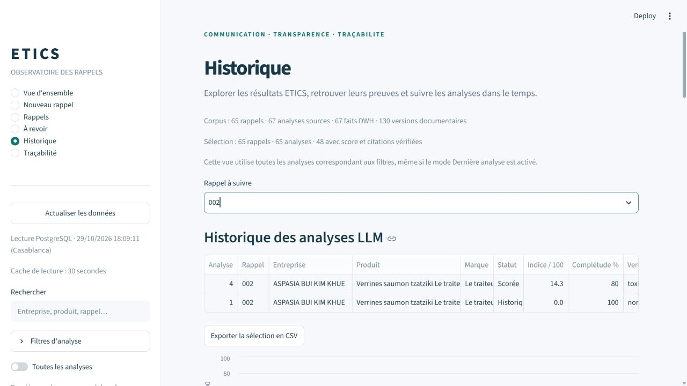
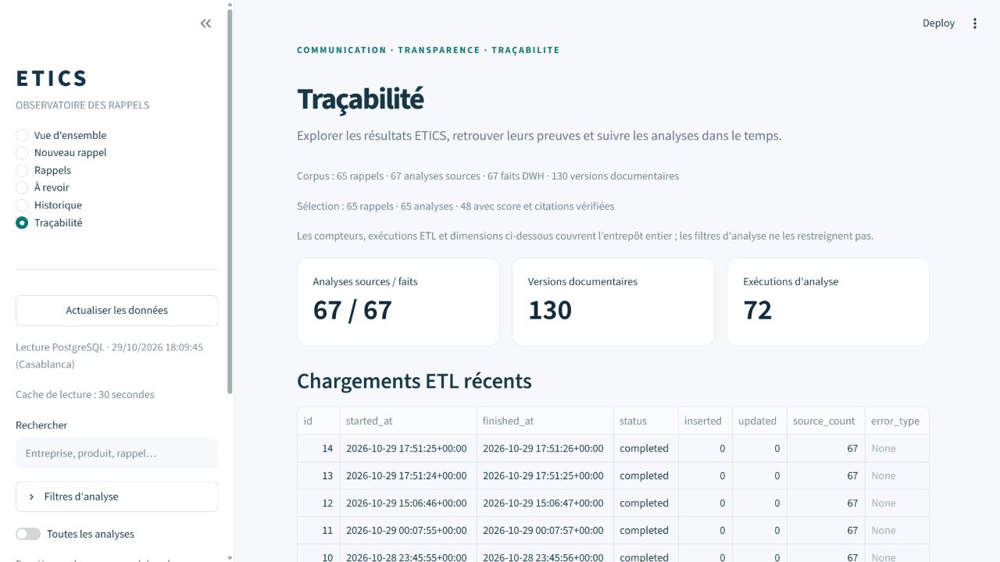

# ETICS — Observatoire de la transparence des rappels

**Comparer les communications de rappel, examiner leurs preuves et conserver l'historique des analyses.**

ETICS rapproche une fiche officielle RappelConso de la communication publiée par une entreprise. Le pipeline Python extrait les documents, soumet un questionnaire structuré à un LLM, contrôle les citations et calcule des indicateurs de transparence. Les résultats sont conservés dans PostgreSQL et consultables dans un dashboard Streamlit.

> L'indice ETICS évalue les problèmes de **communication**. Il ne mesure ni la toxicité chimique d'un produit ni une probabilité de danger. Les verdicts automatiques doivent être interprétés avec leurs sources et leur protocole.



**Python 3.12 · PostgreSQL 16 · SQLAlchemy · Streamlit · Docker Compose · API LLM unique**

[Démarrage](#démarrage-rapide-avec-docker) · [Utilisation](#utilisation) · [Architecture](#architecture) · [Captures du dashboard](#captures-du-dashboard) · [Tests](#tests-et-vérifications) · [Documentation](#documentation)

## Fonctionnalités

| Domaine | Fonctionnalités |
|---|---|
| Documents | Extraction PDF/HTML, nettoyage et structuration des données en JSON |
| Analyse LLM | Questionnaire Q1–Q7, sortie structurée Pydantic et une seule API configurée |
| Preuves et scoring | Contrôle des citations, règles versionnées, statut « à revoir » sans score si les preuves échouent |
| Traçabilité | Sources, empreintes SHA-256, versions documentaires, prompts, modèles et exécutions |
| Data Warehouse | Schéma PostgreSQL `dwh`, table de faits, dimensions et historisation SCD Type 2 |
| Alimentation | ETL transactionnel, reproductible et idempotent à partir de `llm_results` |
| Dashboard | Synthèse, filtres, détail des rappels, citations, historique, traçabilité et export CSV |
| Automatisation | Formulaire de dépôt, file persistante, contrôle des doublons et reprises sur erreur |

## Démarrage rapide avec Docker

### Prérequis

- Docker Desktop démarré, avec les conteneurs Linux et Docker Compose disponibles.
- Le projet présent sur le poste ; exécuter les commandes depuis sa racine.
- Une clé API et du quota disponible pour lancer de **nouvelles analyses LLM**. La consultation des résultats existants ne nécessite aucun appel LLM.

### 1. Préparer la configuration

Sous PowerShell, créer `.env` uniquement s'il n'existe pas déjà :

```powershell
if (-not (Test-Path .env)) {
    Copy-Item .env.example .env
}
```

Renseigner les variables utiles dans ce fichier. Sur une installation existante, conserver les paramètres de connexion de la base déjà créée. Une modification de `POSTGRES_PASSWORD` dans `.env` ne change pas le mot de passe d'un volume PostgreSQL existant.

Le fichier `.env` est ignoré par Git. Aucun secret ne doit être ajouté au README ou aux captures.

### 2. Démarrer les services

```powershell
docker compose up -d
```

Compose construit l'image applicative, démarre PostgreSQL, exécute l'initialisation puis lance le dashboard et le worker. Python et les dépendances sont installés dans l'image ; aucun environnement Python local n'est nécessaire pour ce parcours.

### 3. Ouvrir le dashboard

**[http://127.0.0.1:8501](http://127.0.0.1:8501)**

| Service | Rôle | État attendu après démarrage |
|---|---|---|
| `db` | PostgreSQL et stockage persistant | `healthy` |
| `initialize` | Sauvegarde, migrations, chargement DWH et contrôle de conservation | `Exited (0)` : terminé normalement |
| `dashboard` | Interface Streamlit, port local 8501 | `healthy` |
| `worker` | Traitement des nouveaux dépôts | `healthy` |

La base est accessible depuis le poste sur `127.0.0.1:5433`. Les services applicatifs utilisent le réseau interne de Compose. Les ports publiés sont limités à localhost.

### 4. Consulter l'état et les journaux

```powershell
docker compose ps --all
docker compose logs --tail 100 initialize
docker compose logs -f worker
```

Pour arrêter les services en conservant les données :

```powershell
docker compose stop
```

Le volume `postgres_data` conserve la base. Les dossiers `data/`, `backups/` et `runtime/` sont montés depuis le poste. Ne pas supprimer les volumes pour effectuer un simple redémarrage.

> Les documents du corpus, les résultats PostgreSQL et les sauvegardes ne sont pas distribués automatiquement par Git. Un nouveau clonage peut donc démarrer avec un dashboard vide : déposer des documents ou reprendre une base existante selon la documentation.

## Utilisation

### Consulter une analyse

1. Utiliser la **Vue d'ensemble** pour examiner les compteurs et la distribution des scores.
2. Rechercher un produit ou une entreprise, puis appliquer les filtres souhaités.
3. Ouvrir **Rappels** pour consulter Q1–Q7, le score, les citations et les documents liés à l'analyse.
4. Utiliser **Historique** pour retrouver les analyses successives d'un rappel et leur protocole.
5. Exporter la sélection en CSV si nécessaire.

Par défaut, la sélection retient la dernière analyse par rappel. L'option **Toutes les analyses** rend aussi visibles les résultats antérieurs. Les vues de consultation n'exécutent pas d'inférence.

### Ajouter un nouveau rappel

1. Ouvrir **Nouveau rappel**.
2. Joindre la fiche officielle et la communication de l'entreprise : PDF ou HTML UTF-8, **20 Mo maximum par document**.
3. Laisser l'identifiant vide pour son attribution automatique ou saisir un nouvel identifiant numérique.
4. Ajouter les URL de provenance si elles sont disponibles.
5. Cliquer **Envoyer et analyser**, puis suivre le traitement sous le formulaire.

Le worker détecte les dépôts complets et enchaîne extraction, préparation, analyse, contrôle des preuves, scoring puis ETL. Les résultats deviennent consultables après le chargement DWH.

Un identifiant déjà utilisé ou une paire de fichiers strictement identique est refusé. Ce contrôle technique ne remplace pas une détection sémantique des doublons produits. Le formulaire ne remplace pas les documents d'un rappel existant et ne relance pas le corpus historique.

## Configuration de l'API

Les paramètres sont décrits dans [`.env.example`](.env.example).

| Variable | Usage |
|---|---|
| `OPENAI_API_KEY` | Clé de l'unique API utilisée pour les prochaines analyses |
| `OPENAI_MODEL` | Identifiant du modèle accepté par le fournisseur |
| `OPENROUTER_BASE_URL` | URL de base du service compatible avec le client OpenAI |
| `LLM_API_TIMEOUT_SECONDS` | Délai maximal d'une requête |
| `LLM_MAX_OUTPUT_TOKENS` | Budget maximal de sortie |
| `LLM_DISABLE_REASONING` | Option de désactivation du raisonnement, si prise en charge |
| `DATABASE_URL` | Connexion SQLAlchemy pour l'exécution Python locale |
| `POSTGRES_DB`, `POSTGRES_USER`, `POSTGRES_PASSWORD` | Configuration PostgreSQL de Compose |
| `DASHBOARD_DATABASE_URL` | Connexion dédiée facultative pour le dashboard hors Docker |

Le client utilise **une seule API**. Les anciennes variables `LLM_API_2_*` et `LLM_API_3_*` sont ignorées. Les métadonnées des analyses anciennes restent conservées avec leur fournisseur et leur modèle d'origine.

Les reprises automatiques du SDK sont désactivées. En cas d'indisponibilité, le worker applique une reprise différée sur la même API, au maximum trois tentatives par traitement. Consulter [AUTOMATISATION.md](AUTOMATISATION.md) pour les pauses et les reprises explicites.

## Architecture



Le LLM reçoit directement les deux textes du cas étudié. Aucun chatbot ni RAG n'est implémenté dans cette version.

### Questionnaire et interprétation

| Critère | Information recherchée |
|---|---|
| Q1 | Danger explicitement nommé |
| Q2 | Cause ou origine du défaut indiquée |
| Q3 | Conduite à tenir par le consommateur |
| Q4 | Identification précise du produit |
| Q5 | Solution ou droit : remboursement, échange, réparation… |
| Q6 | Formulation vague, ambiguë ou euphémisante |
| Q7 | Minimisation par rapport à la fiche officielle |

La complétude repose sur Q1–Q5. L'indice de problèmes, sur 100, compte les informations manquantes parmi Q1–Q5 ainsi que les réponses positives à Q6 et Q7, avec une pondération égale des sept critères.

- `scored` : contrôle lexical des citations réussi et résultats dérivés calculés.
- `needs_review` : réponse conservée, mais preuves à revoir ; score et verdict restent NULL.
- `legacy_unlinked` : analyse ancienne dont les sources exactes ne peuvent pas être rattachées rétrospectivement avec certitude.

Une citation retrouvée dans un texte ne garantit pas, à elle seule, la justesse du raisonnement ou le bon périmètre produit. La revue humaine reste nécessaire.

### Data Warehouse et historisation

La table `dwh.fact_analysis` conserve **un fait par résultat LLM**. Elle est reliée aux dimensions entreprise, produit, date, modèle, prompt, règles de scoring, exécution et version documentaire.

- Les entreprises et produits utilisent une historisation **SCD Type 2** lorsque leurs attributs observés changent.
- Les versions documentaires conservent textes, empreintes, provenance et dates d'observation.
- L'ETL réutilise `llm_results` et n'appelle pas le LLM.
- Les nouvelles analyses n'écrasent pas les analyses antérieures.
- Les résultats anciens sans contexte documentaire vérifiable restent explicitement identifiés.

**Historique des analyses et historique des communications sont distincts.** Réanalyser un texte avec un autre modèle ne prouve pas que l'entreprise a modifié sa communication. Une seule version documentaire observée ne permet pas de reconstruire ses états passés.

Les requêtes de [src/dwh/queries.sql](src/dwh/queries.sql) permettent l'analyse par entreprise, produit, période et protocole, ainsi que l'examen des changements documentaires réellement observés. Voir [DWH.md](DWH.md).

## Structure du projet

```text
.
├── dashboard/                 # Interface Streamlit et accès aux données
├── src/
│   ├── extraction/            # Lecture PDF/HTML
│   ├── preprocessing/         # Nettoyage et structuration
│   ├── database/              # Modèles SQLAlchemy, provenance et migrations SQL
│   ├── llm/                   # API unique, questionnaire et contrôle des preuves
│   ├── scoring/               # Règles de scoring versionnées
│   ├── dwh/                   # ETL et requêtes analytiques
│   ├── automation.py          # File de traitements et worker
│   └── pipeline.py            # Point d'entrée du pipeline
├── prompts/                   # Prompts versionnés
├── tests/                     # Tests unitaires et intégration PostgreSQL
├── assets/screenshots/        # Captures réelles utilisées dans ce README
├── data/                      # Sources, textes et JSON locaux, hors Git
├── backups/                   # Sauvegardes locales, hors Git
├── runtime/                   # État et journaux locaux, hors Git
├── .env.example               # Exemple de configuration sans clé API
├── docker-compose.yml         # Base, initialisation, dashboard et worker
├── Dockerfile
└── requirements.txt
```

## Exécution Python locale

Ce parcours est facultatif : il sert au développement ou à une exécution manuelle du pipeline. Utiliser Python 3.12 et PostgreSQL démarré, avec `DATABASE_URL` configuré pour l'accès depuis le poste.

```powershell
python -m venv .venv
.venv\Scripts\python.exe -m pip install -r requirements.txt
```

Reprendre une base existante avec sauvegarde et migrations :

```powershell
.venv\Scripts\python.exe -m src.database.upgrade --backup-dir backups
```

Cette commande requiert `pg_dump`. Vérifier la compatibilité de sa version avec le serveur et la procédure de restauration ; voir les limites ci-dessous.

Préparer un cas présent dans les documents sources, sans appel LLM :

```powershell
.venv\Scripts\python.exe -m src.pipeline --case 001
```

Lancer une analyse à partir du JSON déjà traité :

```powershell
.venv\Scripts\python.exe -m src.pipeline --case 001 --from-processed --with-llm
.venv\Scripts\python.exe -m src.dwh.etl
```

`--from-processed` évite de refaire l'extraction et la préparation. L'analyse a néanmoins besoin des textes extraits associés. Chaque exécution avec `--with-llm` peut consommer du quota et ajouter une analyse ; elle ne constitue pas une simple actualisation de l'écran.

Pour conserver uniquement les résultats existants et réalimenter l'entrepôt :

```powershell
.venv\Scripts\python.exe -m src.dwh.etl
```

Le lancement local du dashboard et du worker est détaillé dans [DASHBOARD.md](DASHBOARD.md) et [AUTOMATISATION.md](AUTOMATISATION.md). Ne pas lancer un second serveur Streamlit sur le port 8501 si celui de Docker l'utilise déjà.

## Tests et vérifications

Avec les services Docker démarrés :

```powershell
docker compose exec -T worker python -m src.container test -q -p no:cacheprovider
```

Le rôle `test` utilise la base d'administration PostgreSQL pour créer des bases/schémas temporaires ; les tests ne doivent pas prendre la base métier comme cible de remplacement. Les clients LLM des tests sont simulés : la suite ne consomme pas de quota d'inférence.

**Dernière suite complète exécutée le 29 octobre 2026 : 233 tests réussis, 1 ignoré, aucun échec**, dans Docker avec PostgreSQL 16.15. Le test ignoré est la variante SQLite d'un contrôle propre à la migration PostgreSQL. Ces résultats ne certifient pas l'exactitude scientifique des verdicts ni la disponibilité d'un fournisseur externe.

Lors du même audit, les huit instructions SQL analytiques ont été exécutées sur les données réelles. Deux relances de l'ETL ont chacune produit zéro insertion et zéro modification. Les empreintes des 15 tables historiques contrôlées étaient inchangées.

### Corpus présenté dans les captures

État du corpus local au **29 octobre 2026** ; ces nombres ne sont pas des données de démonstration injectées au démarrage.

| Élément | Nombre |
|---|---:|
| Rappels | 65 |
| Analyses conservées | 67 : 65 nouvelles et 2 anciennes |
| Analyses nouvelles scorées | 48 |
| Analyses nouvelles à revoir | 17 |
| Faits DWH | 67 |
| Documents / versions documentaires | 130 / 130 |

Dans ce corpus, chaque document possède actuellement une seule version observée. Les 67 analyses ne représentent donc pas 67 modifications de communication.

## Captures du dashboard

Captures réelles du dashboard local prises le **29 octobre 2026**, sans dépôt de nouveaux documents ni appel LLM. La vue d'ensemble est présentée en tête de ce README. Les modèles affichés sont ceux enregistrés lors des analyses historiques ; ils peuvent différer du modèle actuellement configuré.

### Dépôt d'un nouveau rappel

Deux documents, un identifiant facultatif, les liens de provenance et le lancement du traitement en arrière-plan.



### Détail d'une analyse

Résultat du cas 001 : statut, indice de problèmes, complétude, protocole et réponses aux sept critères.



### Analyses à revoir

Les réponses dont le contrôle des preuves a échoué restent accessibles et ne reçoivent pas de score automatique.



### Historique des analyses

Analyses successives du cas 002, avec séparation du contexte des anciennes analyses et des versions documentaires observées.



### Traçabilité du Data Warehouse

Couverture des sources, exécutions et chargements ETL, avec accès aux dimensions historisées.



## Limites connues et dépannage

| Situation | Point à vérifier |
|---|---|
| Refus API HTTP 402 | Crédit/quota du service ou plafond de la clé. Les historiques restent consultables ; rétablir le quota avant de lancer une nouvelle analyse. |
| Refus HTTP 429 ou API indisponible | Consulter les journaux du worker et la reprise différée ; le statut `healthy` du worker ne garantit pas la disponibilité du LLM. |
| Dashboard vide après clonage | Les données du corpus ne sont pas suivies par Git. Déposer des sources ou reprendre la base existante, puis vérifier l'alimentation DWH. |
| Initialisation en erreur | Consulter `docker compose logs initialize` ; le dashboard et le worker attendent sa réussite. |
| PDF scanné ou page web dynamique | L'extraction attend du texte exploitable ; OCR et rendu JavaScript ne sont pas implémentés. |
| Résultat « à revoir » | Examiner les citations et le périmètre produit. Le contrôle lexical ne valide pas toute la conclusion du LLM. |

**Restauration des sauvegardes : point ouvert.** Le test du 29 octobre 2026 a rencontré une incompatibilité entre `pg_restore 17.11` de l'image applicative et PostgreSQL 16.15 : paramètre `transaction_timeout` non reconnu. La création d'une archive et son checksum ne suffisent pas à valider sa restauration. Aligner les outils sur le serveur et tester la reprise dans une base isolée ; la restauration des archives déjà produites avec les outils 17 doit être vérifiée séparément. Ce README ne déclare pas ce problème résolu.

L'application est destinée à un usage local. Une mise à disposition partagée nécessite notamment une authentification et des rôles PostgreSQL adaptés. Les identifiants entreprise fondés sur des noms et les pages contenant plusieurs rappels demandent une attention particulière lors de l'interprétation des résultats.

## Documentation

| Document | Contenu |
|---|---|
| [DWH.md](DWH.md) | Migrations, modèle de l'entrepôt, SCD Type 2, provenance et limites historiques |
| [DASHBOARD.md](DASHBOARD.md) | Vues, filtres, exports et accès aux données |
| [AUTOMATISATION.md](AUTOMATISATION.md) | Dépôts, doublons, états du worker et reprises sur erreur |
| [src/dwh/queries.sql](src/dwh/queries.sql) | Requêtes pour explorer les scores, verdicts, protocoles et versions observées |
| [.env.example](.env.example) | Variables de configuration à renseigner localement |
