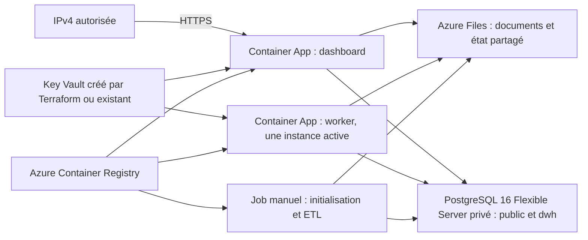

# ETICS — Azure Container Apps avec Terraform

La cible cloud est désormais **Azure Container Apps**, avec PostgreSQL géré et
stockage partagé. Les fichiers Python de l'application, le Dockerfile, Compose et
les migrations existants sont conservés. Le [README principal](../../README.md)
présente aussi cette cible cloud. Compose reste le parcours local.
Les ajouts techniques cloud se trouvent dans ce dossier et `.github/workflows/`.

Aucun push GitHub/ACR, plan authentifié, `apply`, transfert de données ou
provisionnement Azure n'a été exécuté pour préparer cette configuration.

## Architecture



- Dashboard et worker sont deux Container Apps distinctes, sans VM à administrer.
- Un environnement avec profil `Consumption` est intégré au réseau virtuel.
- PostgreSQL 16 utilise un sous-réseau délégué et une zone DNS privée. Aucun accès
  public PostgreSQL n'est activé. Le client demande TLS avec vérification du nom
  et de la chaîne de certificats (`PGSSLMODE=verify-full`).
- Trois partages Azure Files SMB conservent `/app/data`, `/app/backups` et
  `/app/runtime`. Ils sont montés pour l'UID/GID 1000 de l'image.
- L'ACR privé désactive son compte administrateur ; une identité managée reçoit
  `AcrPull`. La même identité reçoit `Key Vault Secrets User` sur le coffre choisi.
- Par défaut Terraform crée le Key Vault dans le groupe applicatif, avec un nom
  stable `kv-etics-<suffixe>`, Azure RBAC, rétention de 90 jours et protection
  contre la purge. Un coffre existant reste utilisable en fournissant son ID ARM.
- Seul le dashboard possède une entrée réseau, HTTPS vers le port 8501, limitée
  à l'IPv4 `/32` configurée. Le worker n'a aucune entrée réseau publique.
- Chaque application garde une instance ; le worker ne doit pas passer à zéro
  puisqu'il surveille la file SQL. La concurrence reste contrôlée par son verrou.

Le filtrage IP n'est pas une authentification utilisateur. Pour un portail partagé,
ajouter une authentification Entra/Easy Auth et adapter les autorisations avant
d'élargir les accès. L'OIDC GitHub du déploiement ne connecte pas les utilisateurs
du dashboard.

## Démarrage et initialisation : trois étapes

Les images `etics-app:local` ne peuvent pas être utilisées directement dans Azure.
Une image doit être construite et publiée dans le registre, avec autorisation.
Le module n'utilise pas de fausse image de démonstration en attendant.

### 1. Fondation

Laisser `app_image=""`, `application_enabled=false`, `database_initialized=false`.
Laisser aussi `key_vault_id`, `postgres_password_secret_id` et
`llm_api_key_secret_id` vides pour le parcours automatique.
Un plan/apply réel crée le réseau, PostgreSQL, l'environnement, l'ACR, les partages,
le coffre Key Vault et les identités/droits. Il ne crée ni application active ni
job sans image. Les valeurs des deux secrets ne sont pas créées par Terraform :
elles doivent être renseignées après cette fondation, avant le job et les applications.

Il faut un abonnement et un budget confirmés : PostgreSQL, ACR, stockage, logs et
réplicas actifs peuvent générer des coûts. Région par défaut : `francecentral` ;
le SKU PostgreSQL `B_Standard_B1ms` et les quotas doivent être vérifiés dans le
compte. Aucun test hors ligne ne prouve leur disponibilité.

### 2. Image, données et initialisation

Après la fondation, renseigner les secrets dans le coffre créé, comme décrit dans
la section « Configuration et secrets ». Le mot de passe doit être celui fourni
à PostgreSQL pendant la première étape. Le nom et les URI se récupèrent avec
`terraform output`, sans copier de valeur secrète dans un fichier Terraform.

Après autorisation, construire et publier l'image à partir du Dockerfile existant.
Exemple de commande à exécuter uniquement après choix du compte et accord sur
l'envoi du code à ACR :

```bash
python infra/azure/scripts/prepare_image_context.py --output DOSSIER_NEUF_HORS_DU_DEPOT
az acr build --registry NOM_ACR --image etics:IDENTIFIANT_DU_COMMIT DOSSIER_NEUF_HORS_DU_DEPOT
az acr repository show --name NOM_ACR --image etics:IDENTIFIANT_DU_COMMIT --query digest -o tsv
```

Ces commandes se lancent depuis la racine du projet ; le dossier de préparation
doit être neuf et situé hors du dépôt. Le script copie uniquement les sources
applicatives du commit `HEAD` ; les modifications non commitées ne sont pas incluses.
Il exclut notamment `.env`, le corpus local et tout le dossier `infra/`, afin de
ne pas envoyer un state, un plan ou une configuration Terraform avec des secrets.
Ne pas lancer `az acr build .` directement depuis un dépôt contenant un state local.
La préparation seule ne construit et ne pousse aucune image.

Renseigner ensuite `app_image=NOM_ACR.azurecr.io/etics@sha256:DIGEST`. Les tags
mutables, notamment `latest`, sont refusés. Garder les applications désactivées.
Un nouvel apply crée le job `init-etics-aca-dev` sans l'exécuter automatiquement.

Avant de reprendre le corpus existant, transférer les documents vers Azure Files
et restaurer une sauvegarde PostgreSQL vérifiée dans la nouvelle base. Ne jamais
remplacer ou supprimer la base locale. PostgreSQL est privé : les outils de
restauration ont besoin d'un accès au VNet, par exemple via un environnement
d'administration approuvé. Ne pas ouvrir sa base à Internet pour contourner cela.
Le module ne copie ni les 65 rappels, ni les 67 analyses, ni les PDF, ni `.env`.

Puis exécuter le job explicitement depuis un poste Azure CLI authentifié :

```bash
python infra/azure/scripts/initialization.py start --resource-group rg-etics-aca-dev --job-name init-etics-aca-dev
```

Le script refuse un lancement s'il détecte déjà une exécution active, puis attend
le résultat de l'exécution qu'il vient de démarrer. Il ne déclare pas un job lancé
comme réussi tant que son état n'est pas `Succeeded`. Les lancements manuels
concurrents hors de ce script restent à contrôler par l'opérateur.

Le job appelle le rôle `initialize` existant : sauvegarde, migrations, ETL et
contrôle des lignes historiques. Il ne lance pas d'analyse LLM. Le parallélisme
est un, sans reprise automatique du job. Un premier lancement sans corpus prépare
une base vide ; il ne fabrique pas de données de démonstration.

### 3. Activation

Après succès du job et vérification des comptages/empreintes :

```text
application_enabled = true
database_initialized = true
```

Un plan/apply crée les deux Container Apps. L'adaptateur
`adapters/cloud_start.py`, injecté dans leur commande de lancement, vérifie en
lecture seule les tables/vues et la migration requise avant d'appeler l'application
existante. Il ne lance pas de migration au démarrage de chaque réplica.

Lors d'une révision, le worker peut attendre le verrou détenu par l'ancienne
révision sans sortir en boucle de redémarrage. Les signaux d'arrêt de la plateforme
sont transmis en SIGINT au processus existant. Sa surveillance fonctionnelle
continue de reposer sur le heartbeat SQL et le suivi du dashboard ; aucune sonde
HTTP de worker non implémentée n'est annoncée.

Le module expose `dashboard_url` uniquement une fois l'application activée.
Son accès nécessite d'être sur l'IPv4 configurée. L'ingress Container Apps prend
en charge le transport HTTP/WebSocket utilisé par Streamlit ; les fonctionnalités
cloud effectives restent à vérifier lors d'un vrai déploiement.

## Configuration et secrets

Terraform 1.17.1 et AzureRM 5.12.0 sont verrouillés avec leurs empreintes Windows et
Linux. Les paramètres locaux remplis, states et plans sont ignorés par Git.

**Aucun coffre préexistant n'est requis.** Par défaut, Terraform crée le coffre,
calcule son ID et les URI ci-dessous. Après la fondation, depuis `infra/azure` :

```powershell
terraform output -raw key_vault_name
terraform output -raw key_vault_id
terraform output -raw postgres_password_secret_id
terraform output -raw llm_api_key_secret_id
```

Ces sorties contiennent des noms et références, pas les valeurs des secrets.
Dans le portail Azure, ouvrir le coffre indiqué, puis **Secrets** et renseigner :

- `postgres-password` : identique au mot de passe initial fourni à PostgreSQL ;
- `llm-api-key` : une seule clé LLM, avec quota disponible pour les futurs dépôts.

Ton compte doit avoir le rôle **Key Vault Secrets Officer**, ou un rôle autorisant
l'écriture des secrets. Le module accorde uniquement la lecture des secrets à
l'identité applicative ; il ne donne pas automatiquement ce droit à l'utilisateur
ou au principal GitHub. Un administrateur RBAC peut attribuer le rôle nécessaire.

Le coffre créé utilise un endpoint réseau public protégé par Azure RBAC ; aucun
Private Endpoint Key Vault n'est provisionné. PostgreSQL reste privé. La protection
contre la purge ne peut pas être désactivée après son activation.

Pour **réutiliser un coffre existant du même abonnement**, fournir `key_vault_id` sur une seule ligne.
Terraform lit ses métadonnées et vérifie qu'il utilise Azure RBAC ; il ne le crée
pas et ne le convertit pas. Les URI sont calculées depuis ce coffre ; fournir les
variables `postgres_password_secret_id` et `llm_api_key_secret_id` uniquement pour
des noms ou versions spécifiques. Les références doivent appartenir au coffre choisi.
Ne pas changer de mode après un déploiement sans examiner le plan : la suppression
du coffre géré serait bloquée par `prevent_destroy`.

Terraform ne lit ni n'écrit les valeurs des secrets Key Vault. Le dashboard et le
job ne reçoivent pas `OPENAI_API_KEY` ; seul le worker la reçoit. Réduire le périmètre
de l'identité si un coffre existant contient des secrets d'autres applications.

Le mot de passe initial PostgreSQL est une variable **éphémère et sensible**, passée
au champ fournisseur **write-only** `administrator_password_wo` : il n'est pas
enregistré comme variable dans le plan/state. Le fournir avec
`TF_VAR_postgres_admin_password`, ou le GitHub Secret du même nom en majuscules.
Ne pas écrire sa valeur dans un exemple ou dans le dépôt. Une rotation exige une
mise à jour coordonnée du secret Key Vault et de `postgres_password_version`.

**Le state reste sensible** : le montage SMB nécessite une clé du compte Azure Files,
qui figure dans le state du fournisseur. Les marqueurs `sensitive` ne chiffrent pas
un state local. Utiliser un backend Blob privé, chiffré, avec contrôle RBAC et
verrouillage ; ne jamais publier les plans, le state ou les fichiers remplis.

## Backend et validations locales

Le backend Blob doit être créé séparément, avec le rôle `Storage Blob Data
Contributor` pour le principal Terraform. Les identités de déploiement ont besoin
des droits de création des ressources et d'attribution des rôles ACR/Key Vault.
Les providers `Microsoft.App`, `Microsoft.OperationalInsights`, `Microsoft.Storage`,
`Microsoft.Network`, `Microsoft.DBforPostgreSQL`, `Microsoft.ContainerRegistry` et
`Microsoft.ManagedIdentity` et `Microsoft.KeyVault` doivent être enregistrés avant
le déploiement réel.

La nouvelle clé de state est `etics-container-apps-dev.tfstate`, dans un groupe
applicatif distinct de l'ancien exemple VM. Aucun `state rm`, destroy ou migration
automatique d'une ancienne VM n'est effectué. Si une VM a été déployée séparément,
conserver son state et traiter son retrait dans une opération distincte.

Sans connexion à Azure :

```powershell
cd infra/azure
terraform fmt -check -recursive
terraform init -backend=false -input=false -lockfile=readonly
terraform validate
terraform test
```

Les tests Terraform utilisent un fournisseur simulé, sans ressource ni donnée
métier créée. Les tests Python des adaptateurs se trouvent dans `tests/` ici et
sont aussi collectés par la suite du dépôt. Une validation ne prouve pas la réussite
des montages SMB, de TLS, de RBAC ou du provisioning dans un abonnement réel.

Pour un vrai déploiement, copier `terraform.tfvars.example` et `backend.hcl.example`
uniquement si les fichiers locaux n'existent pas, remplir les valeurs et fournir
le mot de passe via une variable d'environnement sécurisée. Se connecter avec
Azure CLI et sélectionner l'abonnement. Puis, à chaque étape décrite plus haut :

```powershell
terraform init -reconfigure -backend-config=backend.hcl
terraform plan -out=etics.tfplan
# Relire le plan et le budget avant cette commande de création réelle :
terraform apply etics.tfplan
```

En cas d'utilisation d'un plan sauvegardé, la variable éphémère doit aussi être
disponible pendant l'apply. Le même contexte d'environnement peut la fournir.

## GitHub Actions

La CI existante teste Docker/PostgreSQL, les workflows et Terraform sans clé LLM
ni compte Azure. Le workflow cloud reste manuel, sur la branche par défaut, avec
OIDC et confirmation `CREATE-ETICS-AZURE` pour un apply. Aucun push n'est effectué
par cette préparation.

Environnements GitHub : `azure-plan` et `azure-apply`. Activer les reviewers et
la restriction de branche pour `azure-apply` si le plan GitHub utilisé le permet.
Configurer les sujets fédérés Entra `repo:ORG/DEPOT:environment:azure-plan` et
`repo:ORG/DEPOT:environment:azure-apply`. Ces protections se configurent dans
GitHub/Entra ; le YAML seul ne les crée pas.

Variables de dépôt :

| Variable | Valeur |
|---|---|
| `AZURE_CLIENT_ID`, `AZURE_TENANT_ID`, `AZURE_SUBSCRIPTION_ID` | Identité fédérée et abonnement |
| `TF_STATE_RESOURCE_GROUP`, `TF_STATE_STORAGE_ACCOUNT`, `TF_STATE_CONTAINER` | Backend existant |
| `TF_KEY_VAULT_ID` | Facultatif : vide ou absent pour créer le coffre ; ID ARM pour réutiliser un coffre RBAC |
| `TF_POSTGRES_PASSWORD_SECRET_ID` | Facultatif : URI spécifique ; sinon `postgres-password` dans le coffre choisi |
| `TF_LLM_API_KEY_SECRET_ID` | Facultatif : URI spécifique ; sinon `llm-api-key` dans le coffre choisi |
| `TF_DASHBOARD_SOURCE_CIDR` | IPv4 autorisée en `/32` |
| `ETICS_IMAGE` | Vide au début, puis image ACR par digest |
| `TF_APPLICATION_ENABLED` | `false` au début, `true` après initialisation vérifiée |

Secret GitHub : `TF_POSTGRES_ADMIN_PASSWORD`, identique à la valeur du secret
PostgreSQL du coffre. Ni la clé privée SSH de l'ancien exemple VM ni une variable
`TF_SSH_*` ne sont utilisées.

Parcours manuel GitHub :

1. Fondation : `ETICS_IMAGE` vide et `TF_APPLICATION_ENABLED=false` ; plan puis apply.
2. Renseigner les deux secrets du coffre et, après publication d'image autorisée,
   renseigner `ETICS_IMAGE`, laisser les
   applications désactivées et lancer apply avec `run_initialization=true`.
3. Vérifier les données, puis passer `TF_APPLICATION_ENABLED=true` et lancer un
   nouveau plan/apply. Le workflow vérifie la dernière initialisation réussie avant
   de renseigner l'attestation Terraform.

L'option d'initialisation du workflow concerne la première installation. Les
migrations futures se font en maintenance, après arrêt contrôlé du worker. Ne pas
remettre simplement `application_enabled=false` : cela planifierait la suppression
des applications, bloquée par leur garde-fou. Le succès d'une ancienne initialisation
ne garantit pas la compatibilité d'une future migration avec une nouvelle image.

## Données et limites

La base, le coffre créé, les partages et les applications possèdent `prevent_destroy`. Ce garde-fou
bloque des suppressions/remplacements Terraform tant qu'il reste dans le code ;
il ne protège pas d'une suppression manuelle Azure, d'un code retirant la protection
ou d'une panne. Retirer une protection demande une revue et une sauvegarde vérifiée.

La rétention PostgreSQL est de sept jours, sans HA configurée. Les trois partages
ont une limite de 10 Gio chacun, à adapter au besoin. Une copie indépendante des
documents et des procédures de restauration testées restent nécessaires.

Le problème de compatibilité de restauration client PostgreSQL 17/serveur 16 de
l'image applicative n'est pas corrigé par cet ajout. Avant une vraie migration,
produire/restaurer une sauvegarde avec des outils compatibles PostgreSQL 16 et
vérifier les 65 rappels/67 analyses attendus, sans écraser le poste local.

Le quota LLM, la revue des 17 analyses et la qualité des sources restent des sujets
distincts. L'application utilise encore les droits PostgreSQL du compte configuré ;
prévoir des rôles séparés avant un usage partagé exigeant. Aucun déploiement
cloud fonctionnel ni test d'accès public n'est affirmé à ce stade.

## Sources officielles

- [Stockage partagé Container Apps](https://learn.microsoft.com/en-us/azure/container-apps/storage-mounts)
- [Jobs manuels](https://learn.microsoft.com/en-us/azure/container-apps/jobs)
- [Secrets Key Vault](https://learn.microsoft.com/en-us/azure/container-apps/manage-secrets)
- [Réseau virtuel Container Apps](https://learn.microsoft.com/en-us/azure/container-apps/vnet-custom)
- [Tests Terraform simulés](https://developer.hashicorp.com/terraform/language/tests/mocking)
- [Backend Azure et OIDC](https://developer.hashicorp.com/terraform/language/backend/azurerm)
- [Ressource Key Vault AzureRM 5.12.0](https://github.com/hashicorp/terraform-provider-azurerm/blob/v5.12.0/website/docs/r/key_vault.html.markdown)
- [Droits Azure RBAC pour les secrets](https://learn.microsoft.com/en-us/azure/key-vault/general/rbac-guide)
